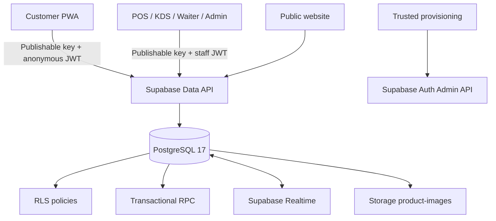

# Architecture

## Topology

## Principles

- PostgreSQL is the source of truth for order state and all monetary calculations.
- Browser applications only use the Supabase publishable key and a user JWT.
- Sensitive writes are implemented as RPCs with explicit execute grants; RLS blocks direct table writes.
- Staff authorization is read from `profiles.role`, not user-editable metadata.
- Realtime is only a delivery mechanism. Every application also performs an initial read after reconnect.
- All front-end strings are Arabic-first and use RTL document direction.
- Each application owns a distinct theme token file.

## Workspace

- `apps/*`: independently deployable Next.js applications.
- `packages/db`: browser client, shared role guard, domain types and Zod schemas.
- `packages/ui`: shared presentational primitives with app-level CSS variables.
- `packages/i18n`: currency and date formatting.
- `packages/realtime`: subscription hook with channel cleanup.
- `supabase/migrations`: ordered database schema and security changes.

## Trusted operations

Staff invitation, role assignment, and disabling staff accounts must be executed by a trusted server process using Supabase Auth Admin API. Never expose a secret key to any Next.js client bundle. Provision the first admin out-of-band, verify it, and rotate credentials before production.
