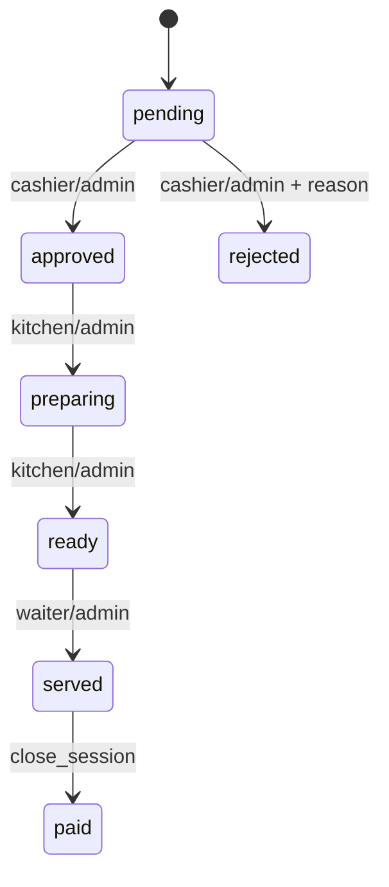

# State machines

## Orders

Direct transitions are rejected by `advance_order`. `paid` is reserved for the transactional `close_session` function.

## Tables

- `available` to `occupied`: only the first successful QR session join.
- `occupied` to `available`: only after successful payment and session close.
- `available` to/from `out_of_service`: admin RPC only, with no open session.
- `occupied` cannot be set manually.

## Sessions

One open session per table, enforced by a partial unique index. The row is locked while the session is joined or closed to prevent conflicting operations.

## Bill requests

`requested → acknowledged → closed`. A partial unique index prevents more than one open request per session.
